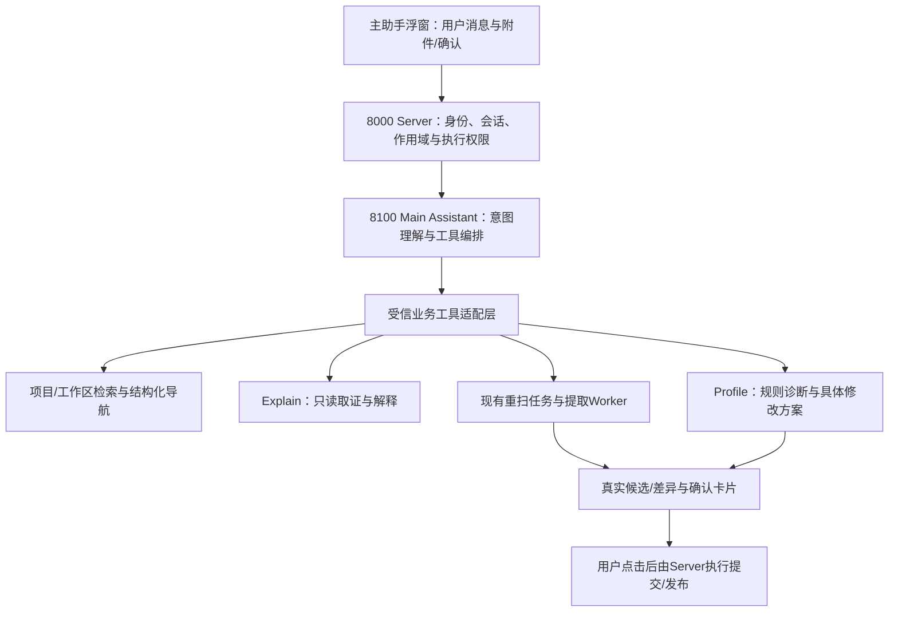

# ADR-0039：主助手接入与现有Agent编排方案

状态：用户已确认，首版代码与离线验收完成；当前服务待重载，真实模型试用未执行。日期：2026-10-19。

## 1. 目标与评价

主助手作为统一聊天入口，负责理解意图、解析对象、调度业务工具/专业Agent、展示结果和接收确认。Extraction负责提取/重扫，Explain负责图纸与线表取证解释，Profile负责规则诊断和修改建议。普通聊天由主助手直接回答。

项目检索与导航通过确定性业务工具完成，不额外调用专业Agent。重扫和规则修改复用已有流程，模型不能直接提交正式数据，也不能凭口头回答生成“执行成功”或确认按钮。用户已有明确请求且范围唯一时，不为只读查询、导航或生成候选重复询问。

## 2. 已核对的现状与缺口

| 当前实现 | 可复用内容 | 本次需要补齐 |
| --- | --- | --- |
| ProjectView/FloatingAgentPanel/AiPanel | 现有浮窗、消息/事件展示、SSE Client | 主助手仍被unavailableReason禁用；需全局会话、显式发送附件和真实能力状态 |
| 旧SupervisorAgent/Graph | ModelGateway、受限意图/命令的思路及通用事件处理 | 旧Handler/AgentBridge仍引用result_proposals、document_files等早期模型；不能直接启用接入当前三表 |
| 当前8100共享宿主extraction_main | Explain、Profile Router及可选提取Worker | 未挂载旧Supervisor；建议新增独立main_assistant编排层，旧控制面保留兼容 |
| ManagementService/ProfileReferences | 已授权项目、索引、线表、数据库规则目录 | 用户可见项目搜索/工作区精确解析、结构化导航动作和可恢复作用域 |
| RescanConnectionsTool/Worker/确认事务 | 指定工作区/页/行、可选参考图、冻结Profile、阶段进度、差异候选 | 主助手适配入口与主会话任务关联；整范围替换沿用ADR-0036 |
| ExplainAgent | 检索分页线表、看原图/目标图、来源证据、只读解释模式 | 工作区概览及冻结规则正文读取；当前ProfileEvidence主要是key/version/checksum，不能据此声称读过实际Prompt |
| ProfileAgent/ProfileEditor/ProfileAuthoring | 读取规则和样例、诊断、具体diff proposal、确认应用和发布新版 | 从所选项目/行定位原冻结包；历史包诊断与最新版本修改分开；现有fork只接受当前可编辑最新版本 |

## 3. 典型请求的处理链路

### 3.1 检索并跳转

请求示例：“找到1002001641 PERU TPP 1 STS项目的020.U工作区”。

1. 在当前用户可见项目中检索项目名称/编号，归一化空格、大小写及业务编号分隔符；保留原始业务码及PDF物理页。
2. 读取已匹配项目的实际drawing_index，定位020.U，包含零记录图纸，不从线表是否有行判断工作区是否存在。
3. 唯一匹配时直接返回并执行navigate动作：真实project_id、workspace_id/code、可选drawing_id、视图模式。
4. 前端由固定路由映射选择项目、展开目录、选中工作区并刷新表格。不能仅跳到项目首页而漏掉工作区选择。
5. 多个同名项目/工作区时展示实际候选（名称、时间、页数等），用户点选；零匹配如实返回。无权限对象不进入候选。

导航事件按event_id去重；断线恢复不重复跳转。若用户等待期间主动切换页面，迟到结果改为可点击“打开目标”，不把用户强行带回旧请求页面。

建议地址约定由代码生成：/projects/{project_id}?workspace={真实工作区ID}&drawing={可选图纸ID}&view={table|preview}。模型只提交结构化目标，不生成任意URL。ProjectView需要读取并验证这些定位参数，支持刷新、前进/后退和旧书签。

### 3.2 工作区/图纸重新扫描

请求示例：“重新扫描这个项目020.U，参考这张截图”或“不提供参考图，重扫020.U”。

1. 解析并显示完整作用域：项目、工作区/图纸/所选行、起点/终点/全部字段、页数、使用的Profile版本。
2. 用户明确要求重扫且范围唯一即可创建候选任务，无需再确认“是否开始”；不明确的范围先追问，不静默扩大。
3. 通过适配器调用现有重扫任务服务，仍由现有提取Worker执行。主助手不经过Explain让模型再判断一次是否应该重扫，也不启动整份PDF重新导入。
4. 读取数据库原图/关联目标图以及原任务冻结的规则包；用户参考图片为可选辅助证据，不作为整页坐标系或替代原PDF。
5. 返回持久task_id，展示进度、取消/重试入口；主会话可以继续检索/问状态，不等待整份工作区扫描阻塞对话。
6. 候选完成后展示实际差异。工作区/页的all沿用replace_scope：完整预览待删旧行和全部新结果，确认后原子替换；行/字段范围沿用patch。空结果删除也需明确预览和确认。
7. 只有用户点击“确认替换所选范围”后由Server提交；失败、拒绝、取消和未确认均保留正式数据。批次/行版本/图纸索引变化时拒绝旧方案。

### 3.3 解释工作区的提取思路

请求示例：“解释020.U下的提取方法”“这组终点是怎么找到的”。

1. 主助手绑定项目/工作区和当前结果批次，调用ExplainAgent只读解释（allow_rescan=false，结果修改工具也不在该轮开放）。
2. Explain先取范围概览，再按需读取代表性记录、来源/目标图及当次实际使用的冻结规则。区分“规则要求如何提取”和“现有证据显示这条记录如何得到”。
3. 工作区很大时先概述，再按用户指定页/端子深入；分页标记覆盖范围，不以少量样本声称已检查全部图纸。不把所有图纸/所有Few-shot同时发送给模型。
4. 没有线表的工作区仍可解释所用规则与原图，明确没有实际提取记录；没有历史调用证据时不编造当时模型的推理过程。
5. 回答附可点击的图纸/记录/规则来源，点击来源继续使用当前预览定位能力。

### 3.4 终点识别错误的规则诊断与修改

请求示例：“这些端子读错了，是不是规则问题？帮我看看，给个修改建议”。

1. 先取得具体记录、用户认为正确的值（如有）、原图/跨页图、原始提取证据及原冻结Profile的key/version/checksum。
2. ProfileAgent结合规则/少样本与实际输出诊断，区分规则缺失、模型偏离、图像不清、跨页匹配/确定性解析问题、用户预期差异和证据不足。一次错误不自动认定为规则问题。
3. 历史项目先分析其实际使用的旧包；不能直接用数据库最新规则替代诊断。现有fork拒绝历史版本，需新增受信的冻结包只读诊断入口，不能绕过当前编辑/发布版本检查。
4. 若当前最新版本已解决问题，说明版本差异，可由用户明确选择用新版重扫指定范围，不重复修改规则。
5. 需要修改时，在当前可编辑版本的隔离草稿上生成具体文件/规则/样例diff，显示证据、建议影响、目标版本和基线checksum。对非本人规则可只读诊断；编辑需有权或由用户选择派生为自己的新规则。
6. 用户看到具体diff后点“确认修改并发布新版”，由Server校验proposal_id、草稿修订及当前源包版本，调用ProfileAgent应用，再沿用现有确认/发布流程生成新版本。一次确认绑定这份具体差异，模型无确认工具。
7. 新版进入以后上传/新任务的规则选择；既有项目继续绑定原版本。若用户希望当前项目受益，明确发起“使用新版重扫指定范围”，候选仍需结果确认。
8. 数据错误可直接走现有结果修订proposal；规则修改与线表修正是两个对象，不把用户纠正自动写成Expected或悄悄改两边。

## 4. 结构与调用边界

- 新主助手建议放services/agent/src/agent/main_assistant，复用ModelGateway/Harness和现有专业Agent接口，不把旧Supervisor里的旧结果表适配原样搬过来，也不重写提取算法。
- Agent工具注册表只开放强类型白名单。现有业务服务通过Server的工具Facade复用；模型不能传owner、凭据、SQL、本地路径或任意Storage URL。
- 建议新增内部工具执行端点供Main运行时调用，使用服务凭据且按持久会话/turn反查真实用户；模型参数不包含可选用户身份。每次执行重新校验实际对象权限。内部端点不直接对浏览器开放。
- 专业Agent通过适配器调用，主助手→子Agent仅一层，避免互相递归。单个明确请求只调必要Agent；检索跳转用业务工具，普通对话不调子Agent。
- 主浮窗由AppLayout级宿主维护，项目/工作区跳转不销毁会话；独立Explain和Profile界面继续可用，主助手也能打开这些页面并定位到具体对象。

## 5. 首版工具范围

| 工具 | 返回 | 是否直接改变正式数据 |
| --- | --- | --- |
| search_projects/list_workspaces/search_drawings/search_connections | 授权对象、稳定ID、分页和覆盖范围 | 否 |
| navigate_to/open_rule/open_profile_draft | 结构化页面定位动作 | 否 |
| get_scope_context/read_bound_profile | 范围概览、当次规则/原图与证据 | 否 |
| explain_scope | Explain公开回答、来源引用、覆盖范围 | 否 |
| start_rescan/get_task_status/cancel_task | 现有任务ID、状态、真实候选或取消回执 | 只创建/取消候选任务；结果不变 |
| diagnose_profile/propose_profile_change | 诊断结论、证据、具体规则diff/proposal | 只作用于隔离草稿 |
| propose_connection_edit | 现有线表差异proposal | 否 |
| start_document_extraction/export_project/list_rule_packages | 现有上传提取/导出与规则目录适配 | 提取需明确PDF/规则；导出只读 |

commit_rescan/commit_connection_edit/apply_and_publish_profile是Server的确认端点，不注册为模型工具。名称修改等普通管理动作可在主助手产生精确操作卡后通过同一确认机制执行；首版不开放模型任意删除项目或批量规则操作。

## 6. 会话、数据与前端协议

### 持久化

建议新增专属assistant_conversations、assistant_turns、assistant_actions、assistant_attachments，避免依赖旧ResultVersion会话结构。实施第一步复核现有通用表，若能完全满足契约则适配复用，不为目录整齐迁移数据。

- conversation按owner隔离，可跨项目；project/workspace/drawing/connection是每轮显式作用域，不能只绑定单一项目。
- turn保存请求标识、范围快照、附件引用、公开消息、工具回执、事件游标及状态；重试沿用turn_id，不重复创建重扫/提案。
- action关联现有rescan_id、proposal_id、profile_draft_id与源版本，不复制原有正式业务事实；确认绑定action+基线hash，幂等/拒绝/过期可追溯。
- attachment先按会话所有者私有保存，明确source/target/detail用途；解析范围后再经适配器绑定到对应项目任务。跨项目不能默默复用旧附件。沿用已有图片大小/像素约束和签名URL，不把全量图片长期放在聊天上下文。
- 新表需新migration、RLS/索引/updated_at及越权测试；主聊天关闭不取消已持久任务，显式取消才调用原任务取消接口。长任务继续由现有Worker运行，不使用生产BackgroundTasks。

### 事件与界面

建议新增/api/v1/assistant/conversations、/turns/stream、/actions/{id}/decision等公共入口，8100增加对应内部Router；DTO由Agent/业务模型生成到Server和TypeScript。旧supervisor端点保留兼容，不继续扩展旧数据模型。

公开事件至少有answer_delta、tool_started/tool_completed、navigate、selection_required、task_started/task_progress、proposal_ready、completed、error。事件带conversation_id/turn_id/event_id，断线后补读持久状态；navigation和proposal必须有真实工具回执，前端不解析自然语言执行动作。

浮窗显示当前解析出的项目/工作区、简短执行说明、流式公开答复、可展开工具结果、来源图纸以及确认/拒绝卡片。附件先暂存，点击发送/Enter才提交，Shift+Enter换行；沿用用户已确认的交互。显示“调用Explain/正在生成重扫候选”等真实状态，不展示内部推理。

作用域默认规则：用户明确指定对象优先；“当前工作区/这几条”使用发送时界面快照；“刚才那个”使用已确认的会话对象。每轮显示实际作用域，页面切换不能让待确认proposal改绑到新项目。

## 7. 权限与确认的默认边界（已确认）

| 动作 | 默认行为 |
| --- | --- |
| 查询、解释、规则诊断、唯一目标导航 | 直接执行 |
| 用户明确要求且范围唯一的重扫 | 直接生成任务/候选，不再询问是否开始 |
| 改正式线表/替换工作区结果 | 展示完整差异后确认；一键“确认替换所选范围” |
| 修改并发布生产规则 | 展示具体diff与版本影响后，一键“确认修改并发布新版” |
| 将新规则应用于旧项目 | 单独明确范围/版本后重扫，结果仍按候选确认 |
| 多个匹配、缺明确对象、版本冲突 | 选真实候选或重新核对差异，不能猜测执行 |

发布验证沿用当前用户已确认的政策：三阶段确认后缺有效起点是warning，可以发布；主助手不额外引入新的质量审批门槛。资源/权限/确认/并发检查保持。

P3也需要验证这类已发布不完整包重新进入编辑草稿时仍沿用该提示政策，不能因为编辑入口没有原Wizard元数据又把同样的起点缺失当成新的硬阻断。

## 8. 分步实施与验收

| 步骤 | 交付 | 退出条件 |
| --- | --- | --- |
| P0：契约与运行骨架 | 主助手DTO/工具Facade/持久会话与RLS、8100挂载、全局浮窗接入；确认卡协议 | 能真实聊天/恢复会话，能力状态准确；默认不调用付费模型测试 |
| P1：检索与跳转 | 项目/工作区/图纸检索，真实候选选择，结构化导航与书签恢复 | 唯一目标自动选中020.U；同名/零记录/无权限正确；跨项目跳转聊天不丢 |
| P2：专业Agent接入 | Explain范围解释和冻结规则、现有重扫工具/可选辅助图/候选确认；普通行修订复用 | 无图/有图均可重扫；只读解释不触发重扫；结果确认仅影响所选范围 |
| P3：规则诊断与确认发布 | 冻结包诊断、最新版本diff、单次确认应用/发布、回执/失败恢复 | 能区分规则/模型/证据问题；无确认不改正式包，确认后出新版本，旧项目不自动改绑 |
| P4：贯通验收 | 超时/重试/取消/断线、权限/版本、用户上下文和附件边界、文档 | 全链路Fake/Mock+API/RLS/浏览器通过；真实模型按显式授权试运行 |

建议作为一个交付任务分阶段实施，P0/P1先打通后持续推进P2/P3；不在只完成聊天外壳时宣称全部Agent已接通。

### 固定验收场景

1. 精确查找示例项目020.U，唯一匹配直接跳转；同名项目返回选择卡；找不到不伪造结果。
2. 无记录但索引中存在的工作区仍能定位、看图、解释和创建重扫候选。
3. 有/无参考图的工作区重扫，页码和Profile冻结正确；引用目标页在范围外时只作读取证据，不能因此替换范围外记录。
4. “解释提取思路”只读；“这几个端子有问题”先获取证据和明确目标，不自动批量修改。
5. 旧规则项目发生问题时分析旧包，发现新版已修复时明确告知；规则修改的diff以当前可编辑版本为基线。
6. 用户确认实际diff后发布新版本；拒绝/并发变化/失权不发布，发布失败能继续重试而不重复应用。
7. 重扫整范围确认可删除旧行/空结果，但必须看完整差异；单字段修订不修改其他字段或跨项目结果。
8. SSE断开、刷新、跨项目导航、关闭/重新打开主浮窗，都不重复创建任务；确认始终绑定原对象。
9. 查询结果/图片内的文字不能升级为系统指令；模型不能请求任意URL/SQL/文件路径/他人附件或直接确认。
10. 类型/lint/build、桌面/窄屏、空/加载/失败/权限/长文本；迁移在空库和旧快照通过，复用的提取/Profile回归保持。

## 9. 本轮边界

2026-10-19用户已确认检索走业务工具、重扫复用候选、规则诊断先确定原因，并授权按方案实施。按P0—P4顺序推进；测试不调用真实模型，不代为重扫或修改真实规则。第7节确认边界生效。

## 10. 实施结果与首版边界

交付记录：[Agent](../service/agent/changelog/2026-10-19-main-assistant.md)、[Server](../service/server/changelog/2026-10-19-main-assistant.md)、[Web](../apps/web/changelog/2026-10-19-main-assistant.md)。新增迁移已通过空库/旧快照测试并部署本地，业务指纹未变。P0—P4的当前核心链路已完成离线与界面验收，当前8000/8100仍运行旧代码，重载后才能实测。

工具命名整合为find_targets/read_scope等强类型入口，未沿用旧表Supervisor Handler。Explain按预算取得绑定规则节选；完整规则诊断交给Profile读取冻结包。重扫沿用既有历史冻结Profile，主助手没有把最新版本改绑旧项目的工具；新规则可用于后续上传。非本人规则只读诊断，自动派生和直接打开专业Agent的任意私有草稿不在本次工具表中，现有独立页面继续可用。

主助手模型回答当前完成后分块输出，工具开始/完成和任务入队即时显示；重扫进度由持久任务卡独立查询。未对现有提取准确率作新的真实模型结论。

## 11. 执行回执硬校验（2026-10-19缺陷修复）

真实会话发现模型未调用工具却口述创建重扫并伪造任务号。修复不能仅扩充成功关键词：无工具最终答复先通过受限结构化核验判断用户所需工具和执行声明；明确执行请求缺回执时最多补调一次，仍缺失则失败，不转发未核验的答复。重扫启动确认由程序从真实UUID/状态回执构造，不再让模型自由改写任务号。

completed携带版本化执行核验元数据，Server在发送最终答复之前核对当前用户/会话/轮次的持久action与关联重扫任务。任务卡也必须通过同样核对。未通过核验的答复不发送、不保存为成功；工具开始与实际入队事件仍即时显示。该变化沿用事件data字段，无新增数据库表/迁移，需8000/8100一起重载。

## 12. 编号范围、无进展循环与复合请求

真实会话将082R5001-05反复作为单个原理号精确查询，耗尽8轮，未进入数据修订/规则诊断。保留8轮总预算，不能通过增大上限掩盖无进展。

检索新增显式多编号；单值先精确匹配，未命中时仅将无歧义且不超过200项的数字尾缀范围展开为精确集合。返回实际匹配编号和范围解释，不把缺失编号补造为记录，不自动修改端子。重复的同参数只读调用复用本轮结果并收紧下一轮工具范围，要求转入后续业务动作或明确缺口。

结构化完成核验支持required_tools任务序列；“修改数据然后更新规则”必须分别调用已有Explain proposal和Profile诊断，不能在第一个专业Agent返回后结束。候选仍分别确认。版本2完成元数据携带每个必需工具的真实action引用，Server核对全部回执；缺任一项不宣称整轮完成。保留版本1兼容，无新增数据库Schema/迁移；内部工具DTO同步生成。

该案例项目仍绑定已合并前的zh_crop2.2.1。编辑目录只在旧key没有可编辑发布包时按已确认的合并关系zh_crop→zh选择正式包；诊断始终读原冻结包，旧项目/Worker不跟随编辑别名、不改绑定。无已登记继任关系则保留诊断并明确提示选择目标，不借用其他模板。

## 13. 工具失败闭环

规则诊断等业务调用的未预期异常必须持久化为failed，并返回稳定安全错误码；日志只记录异常类型与action/turn引用，不输出异常文本、图纸或凭据。主助手遇到工具执行失败即停止本轮，展示具体安全错误和已返回任务/候选保留说明，不让模型重复调用同一故障工具直至耗尽预算。参数格式错误仍可由模型纠正。新一轮由用户显式重试，不自动重启服务或提交已存在候选。

## 14. 本轮目标与历史任务边界

短追问只延续最近相关话题，不能把更早的复合请求累计为本轮待办。跨项目历史保留上下文提示，但不提供为本轮默认执行范围。Server为历史消息补充实际轮次范围/失败状态和持久action状态（包括规则发布版本），不能仅重放旧proposal_ready快照作为未处理候选。

专业Agent返回后，完成分类只依据当前需求与相关历史识别目标；专业诊断正文中的建议不新增用户交付目标。若已核验任务计划不包含某个写候选工具，拒绝其额外调用并保留已有结果，不能因无关动作缺范围把已完成目标判为失败。候选确认/发布仍仅走用户按钮，不由聊天文字执行。
