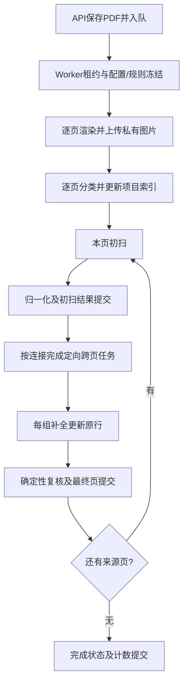

# 上传提取与增量发布

本次实现现有Stage 1分类和Stage 2逐页Graph的在线入口，不增加Stage 3或主Supervisor。设计见[ADR 0022](../../../adr/0022-incremental-extraction.md)。

## 执行与数据

`application/incremental_worker.py`领取`simple_extraction_v1`任务，复用`page_workflow_extraction`。生产Worker无需HTTP端口；可选`src.extraction_main:app`提供8100探活及本地inline Worker。旧`src.main`和旧Agent未清理，新流程不调用它们。

- 图片先存Storage，再发布数据库索引。物理页号决定图纸ID，业务页码用于展示，分类更正不改变物理页身份。
- 初扫与补全使用相同的`project/run/page/unit/connection`身份；页最终提交才删除本页被合并的临时行。原理号不作为唯一键。
- `IncrementalSession`通过独立repository执行事务RPC，不使用旧业务表。成功模型响应和完成页分别缓存；断点恢复复用缓存，下一页在本页保存成功后才开始。
- 规则按注册checksum核对，封装到私有Storage，恢复不依赖之后更改的本地规则。模型/图片预算/输出配置冻结；不兼容配置拒绝恢复。旧项目不会自动重提取。
- 租约120秒，25秒续租；失去租约停止当前执行。DB/权限/保存错误是任务错误，不能当成识图歧义继续花费模型调用。模型响应丢失且未缓存时，恢复仍可能再次调用模型。
- 本地产物在`.runtime/incremental-extraction/<run_id>`，被Git忽略。失败保留已提交数据，显式重试沿用原run/batch。

## 复核契约1.0.0

模型Schema和Few-shot隐藏`status/needs_review/review_reasons/processing_status/completion_*`，共享指令要求只报告事实和`uncertainties`。兼容接受旧响应，但其最终裁决被丢弃。规则资产的端子语义没有另行改写。

统一后处理检查方向依据、实际端子缺失/身份、电位或PLC地址误用、目标不可用/冲突、补全路径依据、视觉歧义及Profile一致性。缺电流、颜色、坐标、业务分类或低置信度不单独触发review。初扫阶段等待引用补全是`pending_completion`，页最终仍不明确才留下复核原因；未知字段保持null。页面身份歧义也保留页级复核状态。

`needs_review`和结构化原因同步到连接、扁平行、数据库evidence和API。公共模型使用延迟导出，解决独立导入提取Agent的循环依赖，原46个导出保留。ZH本地版本仍2.1.1，资源摘要同步公共契约变化，未发布生产Profile。

## 验证与限制

62项Agent测试通过，Fake VLM覆盖真实图片资源的字段级回放、请求Schema/Few-shot、方向/引用、分支、坐标、初扫/补全同ID及完成页恢复；Profile冻结恢复和存储权限错误也有离线用例。测试中修正了先前已过时的target-only、XMZ证据开关和连接签名断言；控制字段改为验证程序契约，事实字段继续逐项比较。

模型的耗时、重试、usage、输入页和Prompt/Profile摘要记录在受租约保护的阶段产物中，不保存请求凭据。

没有调用付费模型，没有重跑用户PDF，没有写入当前项目库或重启现有服务。启用需要应用新增迁移、重载8000 API并启动新Worker，见[Agent README](../../../../services/agent/README.md)。浏览器和SQL验证见Server/Web同日交付记录。
