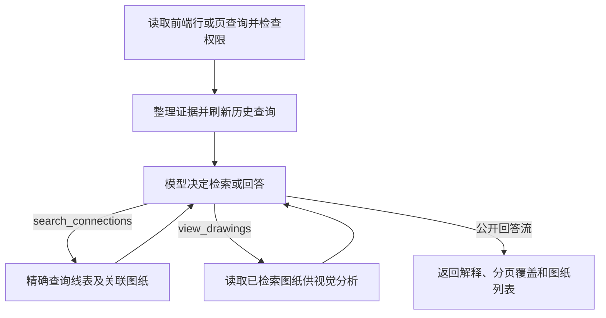

# Explain Agent

独立的线表来源解释与多轮交流能力，使用LangGraph和原生工具调用。前端可指定一行或页码等精确条件，模型继续检索线表/跨页图纸并按需看图。兼容原行级入口；不依赖旧Supervisor、不新增端口、不修改线表/规则或创建提取任务。

## 工作流



仅查询extraction_projects、extraction_connection_rows和必要的extraction_profiles。每次业务检索与图像读取验证所有者/项目；行入口校验可选batch_id/record_version，页查询默认取drawing_index.active_batch_id，无当前批次时明确返回空结果，不混读旧批次。

规则证据优先用该行evidence.profile冻结版本，回退项目引用时标明不能证明历史版本。来源说明/引用/方向依据/复核原因和当前字段与原提取值差异如实展示；缺少的历史过程不补造。当前看图与历史提取说明分开解释。

## 工具

`search_connections`接受ConnectionQuery。项目、批次和身份由程序绑定，模型不能覆盖，也不能传SQL、URL或Storage路径。

| 参数 | 精确匹配含义 |
| --- | --- |
| drawing_page / pdf_page_number | 来源业务页 / 来源PDF物理页 |
| target_drawing_page / target_pdf_page_number | 目标业务页 / 目标PDF物理页 |
| principle_number / wire_number | 原理号 / 线号 |
| start_terminal / end_terminal | 起点 / 终点端子完整字符串 |
| workspace_code / connection_id | 工作区 / 行ID |
| offset / limit | 稳定排序分页，默认0/50，每次最多100行 |

至少一个筛选字段；多个条件为AND，不改大小写、去空格或模糊匹配。只传drawing_page可查该页作为来源的记录；查该页作为终点用target_drawing_page。两个方向分别查询后按行ID核对，避免混淆来源页含义。

前端初始选择由程序预取；后续检索与翻页由模型调用工具。has_more=true时按next_offset继续相同查询。程序计算coverage，未取完时即使模型提前停止，也明确标注没有覆盖全页。每轮最多8次工具调用，达到上限进入回答。

`view_drawings`接受pdf_page_numbers数组，只能读取已检索drawings中的物理页。每次最多4页，每轮最多6页；从受控私有Storage下载，按最长边1536px和单图100万像素缩放后转为内联图像给模型。原图仍用于界面展示；图像过细无法辨认时说明限制。提供商须支持function calling；看图还需支持image_url多模态输入。不静默退回无工具模式。

## 请求与结果

宿主校验JWT/内部身份后构造ExplainActor，不能信任正文中的user_id。ExplainTurn的connection_id与query必须且只能提供一个；record_version仅用于行入口。

```python
from src.agent.explain_agent import (
    ConnectionQuery,
    ExplainActor,
    ExplainTurn,
    create_explain_agent,
)

agent = create_explain_agent()  # 宿主初始化后复用
actor = ExplainActor(user_id=authenticated_user_id)

# 原有行入口
result = await agent.ask(
    ExplainTurn(
        project_id=project_id,
        connection_id=connection_id,
        message="这个终点是如何确定的？",
    ),
    actor,
)

# 整页入口，HTTP正文也使用同样的query对象
result = await agent.ask(
    ExplainTurn(
        project_id=project_id,
        query=ConnectionQuery(drawing_page="082R50"),
        message="这一页所有端子如何提取，涉及哪些跨页？请结合图纸解释。",
    ),
    actor,
)

# 也可组合精确字段
query = ConnectionQuery(drawing_page="082R50", principle_number="082R5001", start_terminal="XD3:251")
```

返回ExplainResponse：

- answer：公开解释。context：行入口仍为ExplainContext（row/profile/recorded/evidence_path/gaps/drawings）；query入口为SearchResult（query/batch_id/rows/drawings/has_more/next_offset/gaps），rows逐行保留原证据契约。
- retrievals：模型工具检索及本轮刷新结果；coverage：按精确条件汇总已返回记录数和分页完整性。
- drawings：本轮全部检索关联图纸，按物理页去重，connection_ids关联线表；每行端点坐标保留在该行context。role=reference只表示唯一索引匹配的引用候选图，不证明终点。
- visual_pages：本轮实际提供给模型的图像物理页。retrieval_limited/gaps：调用上限、缺图与未覆盖范围。history_reset/cached：上下文变化及重放状态。

图片使用当前项目命名空间、配置私有桶和300秒签名地址。签名URL只返回界面，不能把完整带签名响应再次作为主Agent文字事实包；使用context.model_facts()及retrievals中每项的同名方法。看图工具使用内联字节，不将签名或Storage路径传模型；图像不进入公开SSE state。

会话按用户+conversation_id隔离，固定前端初始选择；追问沿用会话，使用新turn_id。模型可在当前项目/批次继续查询其他页；更换前端初始选择则新建会话。重试沿用turn_id及相同正文。每轮重查此前工具查询和已查看图片摘要，数据库/图像/Prompt变化使缓存失效并清除旧历史。默认128会话、24条/约24000字符短期历史、12条turn缓存；同会话忙时返回CONVERSATION_BUSY。重启不恢复聊天。

## 接入与CLI

api.create_explain_router(agent, actor_dependency)要求宿主注入已验证的ExplainActor：

```python
from src.agent.explain_agent.api import create_explain_router

app.include_router(create_explain_router(agent, get_authenticated_actor), prefix="/api")
```

- POST /v1/explain/turns：完整JSON，模型由问题决定是否调用工具。
- POST /v1/explain/turns/stream：tool_started → tool_completed/tool_failed，初始检索后发送context，模型检索还发retrieval；公开回答用answer_delta，最后completed。工具事件返回已校验参数、只读结果和安全错误；不公开原始参数文本、内部推理或图像base64。error帧包含status/code/message；宿主鉴权失败在开始流前返回HTTP错误，断连取消当前任务。

2026-10-17已接入8000代理与8100共享宿主src.extraction_main，前端行/页悬停打开独立浮窗。Server校验JWT/项目权限后注入X-Explain-User-Id，Agent先检查内部令牌再读取数据。生产缺令牌时拒绝；不新增端口。实际本地服务需加载新代码，未自动重启或调用真实模型。启动步骤见[Agent README](../../../README.md)。

公共Pydantic适配器由services/agent/scripts/export_explain_contract.py生成到Server，不导入Agent执行代码；契约测试比对Schema。改动models后先生成适配器，再导出API OpenAPI及Web类型，命令见Server README。

在仓库根目录执行，配置沿用services/agent/.env。以下真实模型命令仅供显式手工联调，本次未执行：

```powershell
$env:PYTHONPATH="services/agent"
.\.venv\Scripts\python.exe -m src.agent.explain_agent --help
.\.venv\Scripts\python.exe -m src.agent.explain_agent `
  --project-id "<project UUID>" --actor-id "<owner UUID>" `
  --drawing-page "082R50" --question "解释本页端子及跨页来源" `
  --allow-real-model --interactive
```

旧行入口用--connection-id，不能与查询参数混用。没有--allow-real-model会在加载数据库/模型配置前退出；CLI仅供可信本地用户，不可替代HTTP鉴权。

## 文件与验证

models.py定义Pydantic契约；repository.py负责权限/精确查询/受控图片；tools/注册工具；graph.py编排条件循环；evidence.py整理可核对依据；service.py管理短期会话；factory.py装配依赖；api.py适配HTTP/SSE；prompts/explain.md定义解释角色。

```powershell
.\.venv\Scripts\python.exe -m pytest services/agent/tests/unit/test_explain_agent.py services/agent/tests/unit/test_explain_retrieval.py services/agent/tests/unit/test_explain_gateway_tools.py -q
```

测试使用FakeModelGateway、MockTransport和TestClient，覆盖条件、分页、工具循环、权限、图纸/图片摘要、缓存和原生工具分片；具体通过数及旧测试问题见[交付记录](../../../../../docs/service/agent/changelog/2026-10-16-explain-retrieval.md)。未调用真实数据库/Storage/付费模型，未修改提取或前端、未重启服务。真实提供商工具/视觉兼容与前端联调待接入。
